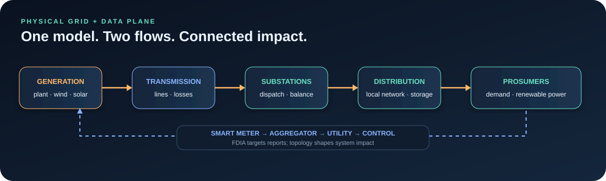
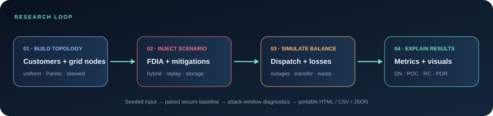

<div align="center">

# PyASPG
### Smart grid resilience, aggregation topology and FDIA research

**Build a grid. Shape its connectivity. Stress it with attacks. See what breaks.**

[](https://www.python.org/)
[](#quickstart)
[](#paper-inspired-research-model)

</div>

PyASPG is an extensible smart-grid simulator for studying consumers/prosumers, aggregators, substations, generation, storage, communication and false-data injection attacks. The repository combines its original component-based SimPy grid with a new deterministic time-slotted research model designed for fast, repeatable topology and attack experiments.

<p align="center"></p>

## What you can explore

- **Topology-aware grids:** assign prosumers independently to aggregators and physical substations, with uniform or Pareto concentration and configurable skew.
- **FDIA scenarios:** inflation, deflation, topology-aware hybrid manipulation, replay, bounded noise, ramping and reporting outage.
- **Resilience measures:** Deviation from Nominal (DN), Power Outage Count (POC), Redistribution Cost (RC), Potential Outage Risk (POR), unserved energy, energy waste and report error.
- **Mitigations:** safety-margin sweeps, inter-substation redistribution, local battery storage, and paired secure/compromised runs on the same seeded demand profile.
- **Reusable outputs:** tidy CSV time series, JSON experiment configuration and metrics, and a self-contained responsive HTML dashboard with SVG charts and a topology view.

## Quickstart

Install [uv](https://docs.astral.sh/uv/), sync the project environment, then run the paper-inspired hybrid FDIA demonstration:

```bash
git clone https://github.com/j0m0k0/PyASPG.git
cd PyASPG
uv sync
uv run pyaspg-research --attack hybrid --output simulation_results/hybrid
```

Open `simulation_results/hybrid/report.html` in a browser. The run writes `timeseries.csv` and `metrics.json` beside the report. It uses only the Python standard library in addition to the repository's existing dependencies.

The checked-in [sample dashboard](visuals/demo/report.html) gives you a quick look at the charts and topology view without running a simulation first.

Try other scenarios:

```bash
uv run pyaspg-research --attack deflation --safety-margin 1.05 --output simulation_results/deflation
uv run pyaspg-research --attack hybrid --topology uniform --substation-topology balanced --output simulation_results/balanced
uv run pyaspg-research --attack hybrid --no-redistribution --battery-share 0 --output simulation_results/no-flexibility
uv run pyaspg-research --attack ramp --strength 0.15 --seed 7 --output simulation_results/ramp
uv run pyaspg-research --attack hybrid --battery-share 0.10 --output simulation_results/storage-mitigation
```

## Paper-inspired research model

The new `pyaspg.research` layer implements the core experiment abstractions from:

- *The Role of Aggregator Topology on the Impact of False Data Injection Attacks* (2025): market concentration, inflation/deflation, generation deviation and outage impact.
- *Topology-Aware Hybrid FDIA Against Third-Party Aggregators*: stealthy mixed inflation/deflation across an aggregator's customers, physical substation awareness, power redistribution, storage, and DN/POC/RC/POR metrics.

Hybrid manipulation shifts reported load between cohorts at different substations while bounding each customer's change and keeping the compromised aggregator's aggregate report close to its true total. A paired secure run establishes the DN baseline. The simulator records substation deficits, redistributes surplus when enabled, and tracks a local storage buffer.

```python
from pyaspg.research import SimulationConfig, run_simulation
from pyaspg.research.report import render_report

result = run_simulation(SimulationConfig(
    attack="hybrid",
    attack_start=80,
    attack_end=100,
    aggregator_topology="pareto",
    substation_topology="skewed",
    safety_margin=1.10,
    seed=42,
))
print(result.metrics)
render_report(result, "simulation_results/my-study")
```

Run the script from the synced environment with `uv run python my_experiment.py`.

### Metrics

| Metric | Interpretation |
| --- | --- |
| DN | Cumulative absolute generation difference from the secure case, normalized by secure generation. |
| POC | Average number of substations in outage per attack-window time step; `outage_events` also gives the total. |
| RC | Transfer amount raised to a configurable exponent, weighted by distance and inverse line reliability. |
| POR | Share of attack-window steps whose net surplus ratio is below the configured risk threshold. |
| Unserved energy | Total demand deficit remaining after storage and redistribution, integrated over `timestep_hours`. |
| Energy waste | Generated surplus remaining after demand and line losses, integrated over `timestep_hours`. |

## Architecture

The research pipeline is intentionally separated from the legacy SimPy component simulator. This keeps the paper model reproducible and fast while allowing the existing component types and handlers to continue serving detailed custom grids.

<p align="center"></p>

## Existing component simulator

The original API remains available from `pyaspg`: `PyASPGCreator`, `GridSimulator`, prosumers, meters, aggregators, substations, distributors, transmitters, generators and control systems. See `examples/others/1.simple_grid.py`, `examples/secure_mode.py` and `examples/compromised_mode.py` for those workflows.

## Model scope

The research layer is an abstract, time-slotted power-balance model. Demand and generation values are interpreted as kW and integrated metrics as kWh using `timestep_hours` (one minute by default). It is useful for comparing scenarios and reproducing system-level FDIA effects; it is not an AC power-flow solver, state-estimator implementation, protection simulator or operational dispatch recommendation. Randomness is seeded and paired runs reuse the same load, topology and forecast realization for fair comparisons.

## License

The original project README identifies the project as MIT licensed. The checkout currently has no `LICENSE` file.
